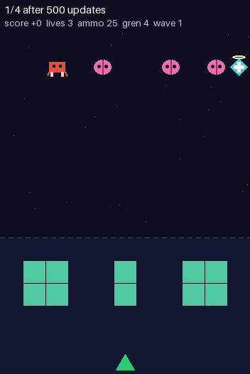

# Mini Invaders: A2C in a non-stationary game
 

 
An A2C agent learns to survive and fight from experience alone.
Course project for MMC201 (IMCA-UNI), based on Zhao, *Mathematical Foundations of Reinforcement Learning* (2025).
 
## Run
 
```bash
pip install numpy pillow matplotlib
python watch.py              # watch the trained agent (--manual to play yourself)
python train_a2c.py          # train (--algo qac, --nstep, --envs, --entropy, --resume)
```
