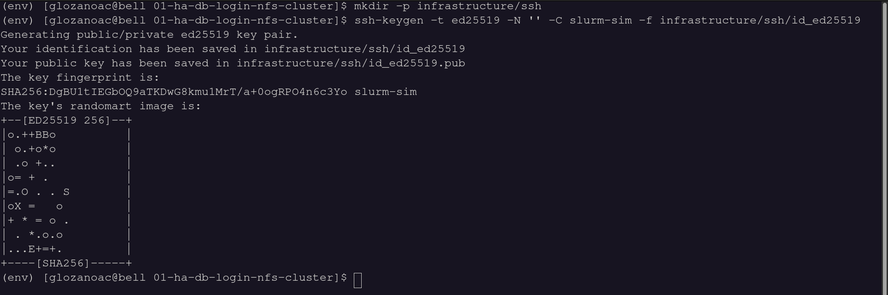
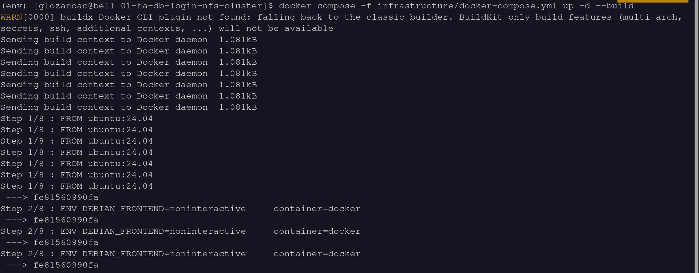
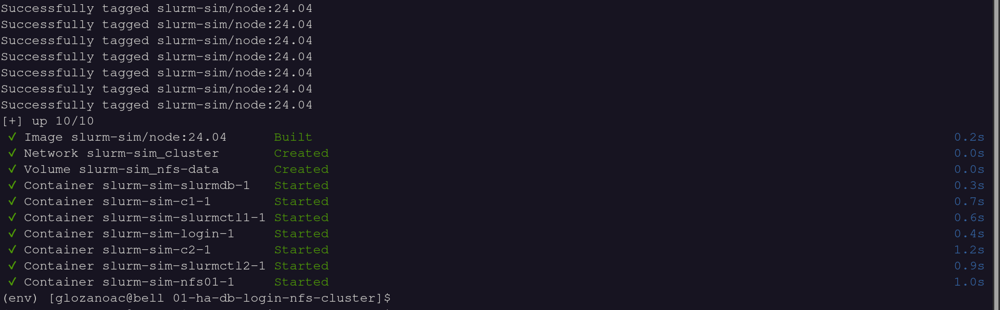
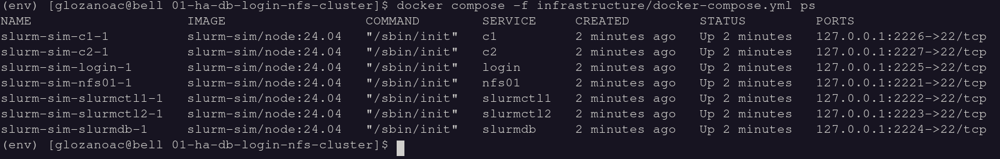
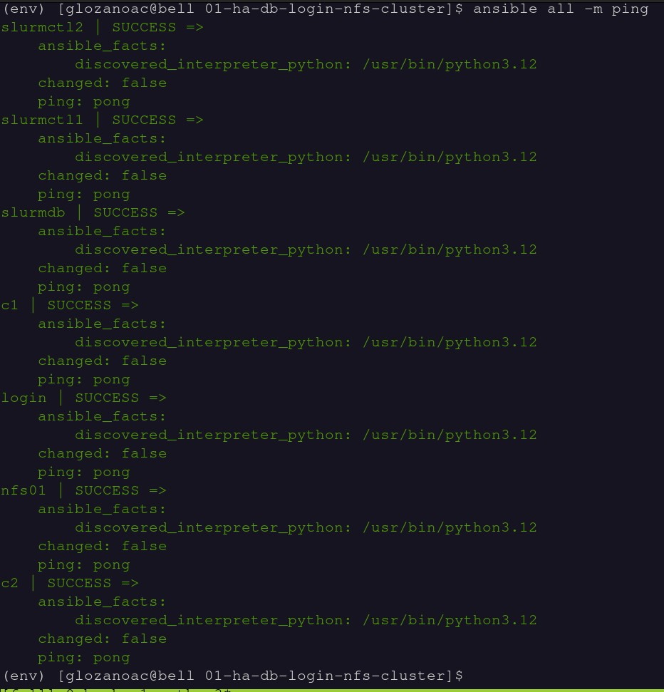
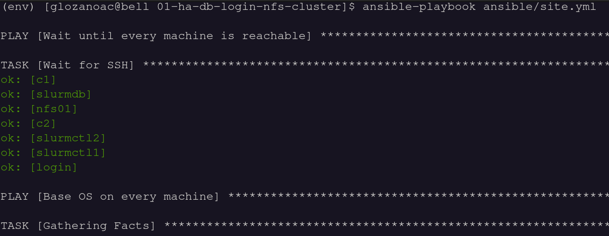

# Slurm Cluster with Ansible: Provisioning Guide

These Ansible playbooks build a Slurm cluster on Ubuntu 24.04 with high
availability, job accounting, a login node and shared storage. You run them
from your own machine over SSH.

```
                              +-- nfs01      NFS: /home + controller state
                              +-- slurmctl1  slurmctld (primary)
your machine (Ansible) --SSH--+-- slurmctl2  slurmctld (backup)
                              +-- slurmdb    slurmdbd + MariaDB (accounting)
                              +-- login      users log in and submit jobs
                              +-- c1, c2     slurmd (compute)
```

| Role | Inventory group | What runs there |
|---|---|---|
| Shared storage | `nfs_server` | NFS server exporting `/home` (to login + compute) and the controller state directory (to the controllers) |
| Controllers | `slurm_controller` | `slurmctld`. The first host is the primary and the others are backups; they share their state over NFS |
| Accounting | `slurm_dbd` | `slurmdbd` + MariaDB: job history (`sacct`), accounts, users, limits |
| Login | `slurm_login` | client commands and compilers; no daemons |
| Compute | `slurm_compute` | `slurmd` |

All Slurm machines also run MUNGE, which authenticates every message between
the Slurm daemons and commands.

**Run every command in this guide from the repository root**, where
`ansible.cfg` lives.

---

## 0. Requirements on your machine

| Tool | Needed for |
|---|---|
| ansible-core >= 2.15 (`pipx install ansible-core`) | provisioning |
| OpenSSH client (`ssh`, `ssh-keygen`) | reaching the machines |
| Docker + Compose v2, Linux host | only if you simulate the machines (step 1) |

---

## 1. Get the machines

You need 7 machines: one NFS server, two controllers, one database node, one
login node and two compute nodes. Each needs:

- Ubuntu 24.04
- reachable over SSH from your machine
- an account that is root or has `sudo`
- a stable IP address on the same network as the others (the NFS exports are
  restricted to these IPs)

If you have such machines, skip to step 2.

**No hardware? Simulate the machines.** `infrastructure/docker-compose.yml`
starts 7 containers that behave like plain Ubuntu servers. They run systemd
and SSH, share a private network, and have **no Slurm or NFS software
installed**.

The simulated NFS server and clients use your host's kernel. It must provide
the NFS modules, and they must be loaded before the containers start
(Docker Desktop on macOS/Windows cannot do this):

```bash
sudo modprobe nfs nfsd
```

Then:

```bash
# SSH key that the simulated machines will accept for root
mkdir -p infrastructure/ssh
ssh-keygen -t ed25519 -N '' -C slurm-sim -f infrastructure/ssh/id_ed25519
```



```bash
# build the image and start the machines
docker compose -f infrastructure/docker-compose.yml up -d --build
docker compose -f infrastructure/docker-compose.yml ps     # 7 machines "Up"
```





| Machine | Role | SSH from your machine |
|---|---|---|
| `nfs01` | NFS server | `127.0.0.1:2221` |
| `slurmctl1` | primary controller | `127.0.0.1:2222` |
| `slurmctl2` | backup controller | `127.0.0.1:2223` |
| `slurmdb` | accounting | `127.0.0.1:2224` |
| `login` | login node | `127.0.0.1:2225` |
| `c1`, `c2` | compute nodes | `127.0.0.1:2226`, `127.0.0.1:2227` |

---

## 2. Set the Ansible inventory

`inventory/hosts.yml` assigns each machine to a role (the groups in the table
above) and says how to reach it. The group `slurm_cluster` gathers every
machine that runs Slurm components.

Host names must equal each machine's short hostname (`hostname -s`), because
Slurm identifies nodes by hostname. The order of `slurm_controller` matters:
the first host is the primary controller.

**Example A: real machines on your network.** Ansible logs in as a sudo user
with your SSH key:

```yaml
all:
  children:
    nfs_server:
      hosts:
        hpc-nfs01: { ansible_host: 192.168.1.5 }
    slurm_controller:
      hosts:
        hpc-ctl01: { ansible_host: 192.168.1.10 }    # primary
        hpc-ctl02: { ansible_host: 192.168.1.11 }    # backup
    slurm_dbd:
      hosts:
        hpc-db01:  { ansible_host: 192.168.1.12 }
    slurm_login:
      hosts:
        hpc-login01: { ansible_host: 192.168.1.15 }
    slurm_compute:
      hosts:
        hpc-c01: { ansible_host: 192.168.1.21 }
        hpc-c02: { ansible_host: 192.168.1.22 }
    slurm_cluster:
      children:
        slurm_controller:
        slurm_dbd:
        slurm_login:
        slurm_compute:
  vars:
    ansible_user: admin            # account with sudo on every machine
    ansible_become: true
```

**Example B: simulated machines from step 1.** This is the file as shipped:

```yaml
all:
  children:
    nfs_server:
      hosts:
        nfs01:     { ansible_host: 127.0.0.1, ansible_port: 2221 }
    slurm_controller:
      hosts:
        slurmctl1: { ansible_host: 127.0.0.1, ansible_port: 2222 }
        slurmctl2: { ansible_host: 127.0.0.1, ansible_port: 2223 }
    slurm_dbd:
      hosts:
        slurmdb:   { ansible_host: 127.0.0.1, ansible_port: 2224 }
    slurm_login:
      hosts:
        login:     { ansible_host: 127.0.0.1, ansible_port: 2225 }
    slurm_compute:
      hosts:
        c1:        { ansible_host: 127.0.0.1, ansible_port: 2226 }
        c2:        { ansible_host: 127.0.0.1, ansible_port: 2227 }
    slurm_cluster:
      children:
        slurm_controller:
        slurm_dbd:
        slurm_login:
        slurm_compute:
  vars:
    ansible_user: root
    ansible_ssh_private_key_file: infrastructure/ssh/id_ed25519
    # the simulated machines get new SSH host keys whenever they are recreated
    ansible_ssh_common_args: -o StrictHostKeyChecking=no -o UserKnownHostsFile=/dev/null
```

Check that Ansible reaches every machine:

```bash
ansible all -m ping
```



Every host must answer `pong` before you continue.

### Cluster settings

The main settings live in `inventory/group_vars/all.yml`:

```yaml
slurm_cluster_name: hpc

slurm_partitions:
  - { name: debug, nodes: ALL, default: true, max_time: "01:00:00" }

slurm_accounts:                  # accounts in the accounting database
  - { name: research, description: Research group, organization: hpc }

slurm_cluster_users:             # Unix users + their account association
  - { name: hpcuser, uid: 2001, account: research }
```

Everything else falls back to `ansible/roles/slurm_defaults/defaults/main.yml`,
for example:

| Variable | Default | Meaning |
|---|---|---|
| `slurm_slurmctld_timeout` | `60` | seconds the backup waits before taking over |
| `slurm_accounting_enforce` | `associations,limits,qos` | only users with an account association can submit |
| `nfs_shares` | `home`, `slurmctld` | what `nfs01` exports and who mounts it where |
| `nfs_mount_options` | `nfsvers=4.2,hard,noatime,_netdev` | NFS client mount options |

Two secrets are generated on your machine on the first run and kept in
`inventory/.secrets/` (git-ignored):

- `munge.key`: the cluster-wide MUNGE key
- `slurmdbd_password`: the MariaDB password used by `slurmdbd`

Back that directory up. If you would rather manage the password yourself, set
`slurmdbd_storage_pass` (ideally with `ansible-vault encrypt_string`).

When the machines are containers, the playbooks detect it and adjust these
settings automatically:

| Setting | Machines | Containers |
|---|---|---|
| `ProctrackType` / `TaskPlugin` | `cgroup` / `cgroup,affinity` | `linuxproc` / `affinity` |
| `JobAcctGatherType` | `jobacct_gather/cgroup` | `jobacct_gather/linux` |
| `SlurmdParameters` | (none) | `config_overrides` |
| CPU / memory per node | as detected (minus 512 MB for the OS) | capped at 4 CPUs / 2 GB |
| MariaDB buffer pool | 1024M | 256M |
| chrony, `/etc/hosts` | managed by Ansible | left to the container host |

These container settings exist because containers share the host's kernel,
clock and cgroups, and every container sees all of the host's CPUs.

---

## 3. Provision the cluster

```bash
ansible-playbook ansible/site.yml
```




Add `-K` if your `ansible_user` needs a sudo password.

`site.yml` runs these plays in order:

| # | Play | Hosts | What it does |
|---|---|---|---|
| 1 | Wait for SSH | all | waits until each machine accepts connections |
| 2 | `common` | all | base packages, chrony, `/etc/hosts`, and a `slurm` user with UID/GID 64030 |
| 3 | `nfs_server` | nfs_server | exports `/srv/nfs/home` and `/srv/nfs/slurmctld`, each only to the IPs that mount it, with `root_squash`. Creates user homes and the state directory with the right owners |
| 4 | `munge`, `slurm_users` | slurm_cluster | same MUNGE key everywhere (checked with `munge -n \| unmunge`); users with the same UID everywhere |
| 5 | `nfs_client` | controllers, login, compute | mounts `/home` (login, compute) and `/var/spool/slurmctld` (controllers) through `/etc/fstab` |
| 6 | `slurmd` (detect) | compute | installs `slurmd` and reads the hardware with `slurmd -C` |
| 7 | `slurm_config` | slurm_cluster | writes the same `slurm.conf` and `cgroup.conf` everywhere: both `SlurmctldHost` lines, accounting, and node lines built from the detected hardware |
| 8 | `slurmdbd` | slurm_dbd | MariaDB, `slurmdbd`, then cluster, accounts and user associations via `sacctmgr` |
| 9 | `slurmctld` | controllers | one at a time, primary first; each must report UP in `scontrol ping` |
| 10 | `slurmd` | compute | starts `slurmd` and waits until each node is `idle` |
| 11 | `slurm_login` | login | compilers and a MOTD; checks `sinfo` works |
| 12 | Smoke test | login | `srun hostname` on all compute nodes as `hpcuser`, then checks the job is recorded in `sacct` |

A successful run ends with:

```
msg:
- 'Job ran on: c1, c2'
- 'Accounting: 1              hpcuser   research          c[1-2]  COMPLETED'
```

The playbook is **idempotent**: running it again reports `changed=0`. After
you change the inventory or the settings, run it again. A daemon restarts only
when its configuration changed.

---

## 4. Verify the cluster

Users work on the login node, so most checks run there.

```bash
ansible slurm_login -a "sinfo"
```

```
PARTITION AVAIL  TIMELIMIT  NODES  STATE NODELIST
debug*       up    1:00:00      2   idle c[1-2]
```

**Controllers (HA):**

```bash
ansible slurm_login -a "scontrol ping"
```

```
Slurmctld(primary) at slurmctl1 is UP
Slurmctld(backup) at slurmctl2 is UP
```

**Shared storage:**

```bash
ansible slurm_login:slurm_compute -a "findmnt /home"
ansible slurm_controller -a "findmnt /var/spool/slurmctld"
ansible nfs_server -a "exportfs -v"
```

**Accounting:**

```bash
ansible slurm_dbd -a "sacctmgr show assoc format=cluster,account,user"
```

```
   Cluster    Account       User
---------- ---------- ----------
       hpc       root
       hpc       root       root
       hpc   research
       hpc   research    hpcuser
```

### Job queue

`squeue` lists the jobs that are pending or running. The queue is empty
right after provisioning. To see it in action, submit two jobs as `hpcuser`
that each ask for 2 CPUs and sleep for 2 minutes. `--chdir` sets the job's
working directory, where its `slurm-<jobid>.out` output file is written:

```bash
ansible slurm_login -b --become-user hpcuser \
  -a "sbatch --job-name=sleep-test --chdir=/home/hpcuser --cpus-per-task=2 --wrap='sleep 120'"
ansible slurm_login -b --become-user hpcuser \
  -a "sbatch --job-name=sleep-test --chdir=/home/hpcuser --cpus-per-task=2 --wrap='sleep 120'"

ansible slurm_login -a "squeue"
```

```
JOBID PARTITION     NAME     USER ST       TIME  NODES NODELIST(REASON)
    9     debug sleep-te  hpcuser  R       0:09      1 c2
    8     debug sleep-te  hpcuser  R       0:12      1 c1
```

- `ST` is the job state: `R` = running, `PD` = pending, `CG` = completing.
- For a running job, the last column shows the node it runs on. For a
  pending job, it shows the reason it is waiting, such as `Resources` (no
  free CPUs yet) or `Priority` (other jobs go first).
- `TIME` is how long the job has been running.

Other useful views:

```bash
# one user's jobs, with chosen columns: id, name, user, full state, time, CPUs, node/reason
ansible slurm_login -a "squeue -u hpcuser -o '%.6i %.12j %.8u %.8T %.10M %.4C %R'"

# full details of one job
ansible slurm_login -a "scontrol show job 8"

# cancel one job, or all jobs of a user
ansible slurm_login -a "scancel 9"
ansible slurm_login -a "scancel -u hpcuser"
```

### Job history (accounting)

Finished jobs leave the queue, but they stay in the accounting database:

```bash
ansible slurm_login -b --become-user hpcuser \
  -a "sacct -X -o JobID,JobName%15,Account,NodeList,AllocCPUS,Elapsed,State --starttime=now-1day"
```

```
JobID                JobName    Account        NodeList  AllocCPUS    Elapsed      State
------------ --------------- ---------- --------------- ---------- ---------- ----------
1                   hostname   research          c[1-2]          2   00:00:00  COMPLETED
3                     pi-omp   research              c1          2   00:00:00  COMPLETED
```

Drop `-X` to also see each job's steps (`.batch`, `.0`, ...).

---

## 5. Run the OpenMP job

The job lives in `jobs/openmp/`:

- **`pi_omp.c`** computes pi by numerical integration, first serially and then
  with `#pragma omp parallel for reduction`. It prints which CPU each thread
  is pinned to, plus the speedup.
- **`pi_omp.sbatch`** requests 1 node, 1 task and N CPUs, and sets
  `OMP_NUM_THREADS=$SLURM_CPUS_PER_TASK`, `OMP_PLACES=cores` and
  `OMP_PROC_BIND=close` (each option is commented in the file).

Run it with:

```bash
ansible-playbook ansible/playbooks/openmp_job.yml
ansible-playbook ansible/playbooks/openmp_job.yml -e omp_threads=8   # more threads
```

The playbook does what a user would do on the login node, as `hpcuser`:

1. Copies the files to `~/openmp`. Because `/home` is shared over NFS, the
   compute nodes see the same files.
2. Compiles with `gcc -O2 -fopenmp`.
3. Submits with `sbatch --wait`. It asks for `omp_threads` CPUs (default 4),
   capped at the smallest node's CPU count.
4. Prints the job output and its `sacct` record:

```
Node: c1 | CPUs allocated: 2 | OMP_NUM_THREADS=2
  thread  0 of  2 on CPU 0
  thread  1 of  2 on CPU 1
version                   pi    abs error   time [s]
serial     3.141592653589552    2.411e-13     0.4329
openmp     3.141592653590022    2.287e-13     0.2275
Speedup: 1.90x with 2 threads (efficiency 95%)

JobID           JobName      User    Account        NodeList  AllocCPUS    Elapsed      State ExitCode
------------ ---------- --------- ---------- --------------- ---------- ---------- ---------- --------
3                pi-omp   hpcuser   research              c1          2   00:00:00  COMPLETED      0:0
```

To do the same by hand, log in to the login node as `hpcuser`
(`ssh hpcuser@<login>`, or `su - hpcuser` there):

```bash
cd ~/openmp
sbatch --cpus-per-task=2 pi_omp.sbatch
squeue -u $USER
cat pi-omp-<jobid>.out
```

---

## 6. Test high availability (controller failover)

The controllers share their state over NFS. If the primary stops answering
for `SlurmctldTimeout` seconds (60), the backup takes over, and running jobs
are not affected.

**1. Stop the primary controller:**

```bash
ansible 'slurm_controller[0]' -a "systemctl stop slurmctld"
```

**2. Wait about 60 seconds, then check:**

```bash
ansible slurm_login -a "scontrol ping"
```

```
Slurmctld(primary) at slurmctl1 is DOWN
Slurmctld(backup) at slurmctl2 is UP
```

The backup's log shows the takeover:

```bash
ansible 'slurm_controller[1]' -m shell -a "grep -i 'taking over' /var/log/slurm/slurmctld.log"
```

```
error: ControlMachine slurmctl1 not responding, BackupController1 slurmctl2 taking over
```

**3. Check that the cluster still works:** submit a job, check that it
completes, and check that jobs started before the failover keep running.

```bash
ansible slurm_login -b --become-user hpcuser -a "sbatch --chdir=/home/hpcuser --wrap='hostname'"
ansible slurm_login -a "squeue"
ansible slurm_login -b --become-user hpcuser -a "sacct -X --starttime=now-1hour"
```

**4. Bring the primary back.** It takes control again, and the backup returns
to standby:

```bash
ansible 'slurm_controller[0]' -a "systemctl start slurmctld"
ansible slurm_login -a "scontrol ping"      # both UP again
```

Running `ansible-playbook ansible/site.yml` instead also restarts the primary,
and reports nothing else to change.

---

## 7. Add a user

1. Add the user to `slurm_cluster_users` in `inventory/group_vars/all.yml`,
   with a UID that no other user has and one of the `slurm_accounts`:

   ```yaml
   slurm_cluster_users:
     - { name: hpcuser, uid: 2001, account: research }
     - { name: maria,   uid: 2002, account: research }
   ```

2. Run `ansible-playbook ansible/site.yml`. It creates the Unix account on
   every Slurm machine, the home directory on the NFS share, and the
   association in the accounting database.

3. To let the user log in with SSH, put their public key in
   `/home/<user>/.ssh/authorized_keys`, for example from the login node.

---

## 8. Troubleshooting

| Symptom | Check |
|---|---|
| Node `down` or `drained` | `ansible slurm_login -a "sinfo -R"`, then `ansible slurm_login -a "scontrol update NodeName=<node> State=RESUME"` |
| A daemon won't start | `ansible <host> -a "tail -n 30 /var/log/slurm/slurmctld.log"` (or `slurmd.log`, `slurmdbd.log`) |
| Authentication errors | `ansible slurm_cluster -m shell -a "munge -n \| unmunge"`; clocks must be in sync |
| Jobs rejected: invalid account | the user needs an association: `ansible slurm_dbd -a "sacctmgr show assoc user=<user>"` |
| `sacct` shows nothing | `ansible slurm_dbd -a "systemctl status slurmdbd mariadb"` |
| NFS mount fails | `ansible nfs_server -a "exportfs -v"` (does it list the client's IP?); simulated: is `sudo modprobe nfs nfsd` loaded on the host? |
| Backup never takes over | `findmnt /var/spool/slurmctld` on both controllers must show the NFS share |
| Node marked invalid (wrong CPUs or memory) | compare `slurmd -C` on the node with its `NodeName` line |

---

## 9. Remove the simulated machines

```bash
docker compose -f infrastructure/docker-compose.yml down -v
rm -rf infrastructure/ssh inventory/.secrets
```

---

## Repository layout

```
ansible.cfg                        Ansible settings (run commands from here)
inventory/
  hosts.yml                        machines, roles, how to reach them (step 2)
  group_vars/all.yml               cluster settings, accounts, users
ansible/
  site.yml                         provisions the cluster (step 3)
  playbooks/openmp_job.yml         runs the OpenMP job (step 5)
  roles/
    slurm_defaults                 shared variables (no tasks)
    common                         base OS, chrony, /etc/hosts, slurm user
    nfs_server, nfs_client         shared /home and controller state
    munge                          authentication key
    slurm_users                    cluster users
    slurm_config                   slurm.conf, cgroup.conf
    slurmdbd                       MariaDB, slurmdbd, accounts, associations
    slurmctld                      primary + backup controllers
    slurmd                         compute nodes (hardware detection + daemon)
    slurm_login                    login node
infrastructure/                    optional simulated machines (step 1)
  docker-compose.yml               the 7 machines
  node/Dockerfile                  Ubuntu 24.04 + systemd + sshd
jobs/openmp/                       pi_omp.c, pi_omp.sbatch
```

Software: Ubuntu packages, Slurm 23.11, MUNGE 0.5.15 and MariaDB 10.11.
References: the
[Quick Start Admin Guide](https://slurm.schedmd.com/quickstart_admin.html),
[slurm.conf](https://slurm.schedmd.com/slurm.conf.html) and
[Accounting](https://slurm.schedmd.com/accounting.html).
