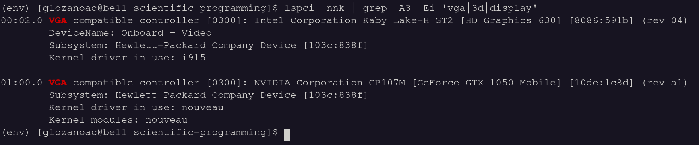
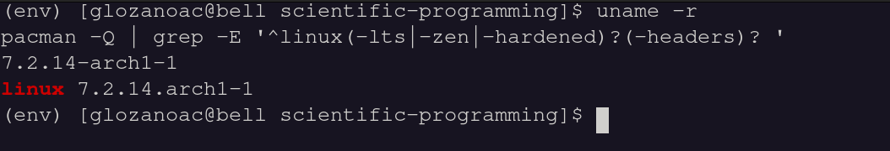
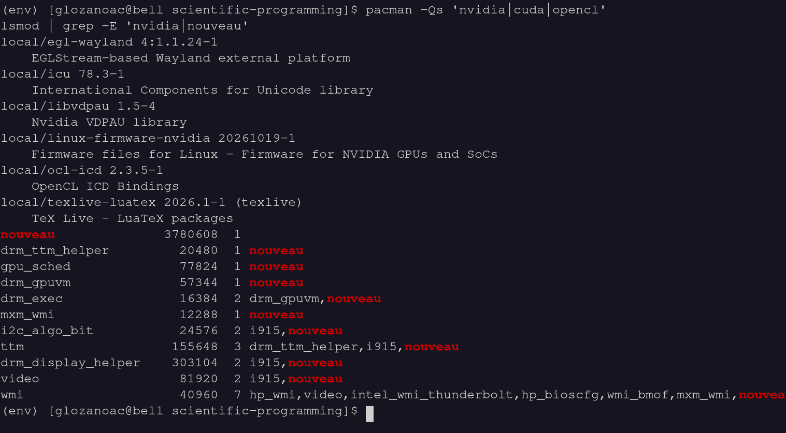
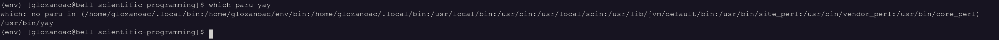
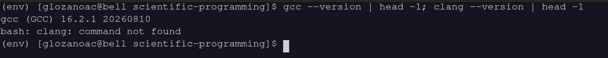
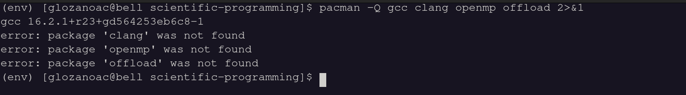
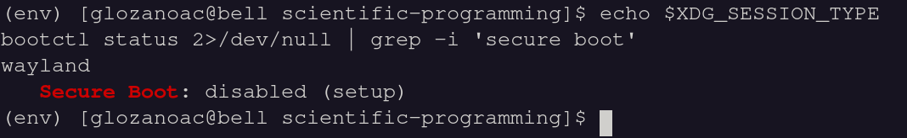
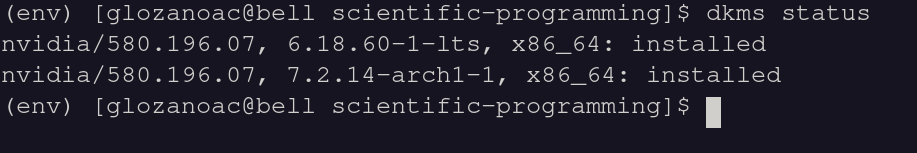

# C / OpenMP / GPU-offload setup — Arch Linux + GTX 1050 Mobile

Setup for these books:

- Kernighan & Ritchie, *The C Programming Language* (2nd ed., 1988)
- Chapman, Jost & van der Pas, *Using OpenMP* (2007)
- van der Pas, Stotzer & Terboven, *Using OpenMP — The Next Step* (2017)
- Deakin & Mattson, *Programming Your GPU with OpenMP* (2023)

Last updated: 2026-11-05

---

## 0. Key facts about this machine

| Item | Value |
|---|---|
| Machine | HP laptop, hybrid graphics (Intel HD 630 + NVIDIA GTX 1050 Mobile) |
| GPU architecture | Pascal, compute capability 6.1 → `sm_61` |
| Main kernel | `linux` 7.2.x |
| Fallback kernel | `linux-lts` 6.18.x |
| Bootloader | systemd-boot |
| Session | Wayland (desktop runs on the Intel GPU) |
| Secure Boot | Disabled (no module signing needed) |
| AUR helper | `yay` |

**Why the setup is unusual (Pascal is legacy):**

- The Arch NVIDIA driver moved to 590, which dropped Pascal. Use the AUR legacy driver: **`nvidia-580xx-*`**.
- CUDA 13.x dropped Pascal. Use the AUR **`cuda-12.9`**. Never install the repo `cuda` package.
- Kernel 7.2 broke older 580 driver builds. That's why `linux-lts` is kept as a boot fallback.

---

## 1. Diagnostics (what was checked and why)

### 1.1 GPU model and hybrid graphics

```bash
lspci -nnk | grep -A3 -Ei 'vga|3d|display'
```



There are two GPUs (Intel + NVIDIA), so the laptop uses hybrid graphics and needs `nvidia-prime`. At this point Nouveau was driving the NVIDIA card.

### 1.2 Kernel (determines the headers package)

```bash
uname -r
pacman -Q | grep -E '^linux(-lts|-zen|-hardened)?(-headers)? '
```



Running `linux` 7.2 with no headers installed, so `linux-headers` is needed.

### 1.3 Existing NVIDIA/CUDA packages and loaded modules

```bash
pacman -Qs 'nvidia|cuda|opencl'
lsmod | grep -E 'nvidia|nouveau'
```



No NVIDIA driver was installed, so this was a clean install. `nouveau` was loaded.

### 1.4 AUR helper

```bash
which paru yay
```



`yay` is available.

### 1.5 Compilers and OpenMP packages

```bash
gcc --version | head -1; clang --version | head -1
pacman -Q gcc clang openmp offload 2>&1
```




GCC 16 only, so `clang`, `openmp` and `offload` were needed.

### 1.6 Session type and Secure Boot

```bash
echo $XDG_SESSION_TYPE
bootctl status 2>/dev/null | grep -i 'secure boot'
```



Wayland, Secure Boot disabled.

---

## 2. Driver installation

```bash
# Update the system, add kernel headers and the LTS fallback kernel
sudo pacman -Syu
sudo pacman -S --needed linux-headers linux-lts linux-lts-headers

# Legacy NVIDIA driver for Pascal + hybrid-graphics helper
yay -S nvidia-580xx-dkms nvidia-580xx-utils opencl-nvidia-580xx
sudo pacman -S nvidia-prime

# Check that the module built for BOTH kernels before rebooting
dkms status
```

Result: the driver built for both kernels.



### Boot entry for the LTS kernel (systemd-boot)

systemd-boot does not add `linux-lts` to the boot menu automatically:

```bash
ls /boot/loader/entries/
sudo cp /boot/loader/entries/<your-entry>.conf /boot/loader/entries/arch-lts.conf
sudoedit /boot/loader/entries/arch-lts.conf
#   vmlinuz-linux          -> vmlinuz-linux-lts
#   initramfs-linux.img    -> initramfs-linux-lts.img
#   title                  -> Arch Linux (LTS)
```

Boot the normal kernel by default. Use LTS only if a kernel update breaks the NVIDIA build.

### Verify after reboot

```bash
lsmod | grep -E 'nvidia|nouveau'   # nvidia listed, nouveau absent
nvidia-smi                         # shows the GTX 1050
```

---

## 3. Toolchain

```bash
sudo pacman -S clang openmp offload gdb valgrind make cmake hwloc numactl perf
yay -S cuda-12.9
```

| Package | Purpose |
|---|---|
| `gcc` | C compiler; `-fopenmp` uses libgomp (CPU OpenMP) |
| `clang` + `openmp` | Second compiler; `-fopenmp` uses libomp |
| `offload` | LLVM OpenMP target runtime (`libomptarget`, NVPTX device runtime) |
| `cuda-12.9` (AUR) | Provides `ptxas`/`nvlink`, which Clang needs to build GPU code for `sm_61` |
| `gdb`, `valgrind` | Debugging, memory errors (K&R exercises) |
| `hwloc` (`lstopo`), `numactl` | Core/cache topology for the affinity chapters |
| `perf` | CPU profiling |

**Note on `cuda-12.9`:** it depends on AUR `gcc14`, which takes hours to compile. Clang only needs `ptxas`/`nvlink`, so you can remove `gcc14` from `depends` when yay offers to edit the PKGBUILD. The cost is that `nvcc` won't work with GCC 16, but none of these books needs `nvcc`.

Find the CUDA path:

```bash
pacman -Ql cuda-12.9 | grep bin/ptxas     # usually /opt/cuda/bin/ptxas
```

---

## 4. Compile commands (cheat sheet)

| Book | Command |
|---|---|
| K&R | `gcc -std=c89 -Wall -pedantic prog.c -o prog` |
| OpenMP on CPU | `gcc -O2 -fopenmp prog.c -o prog` or `clang -O2 -fopenmp prog.c -o prog` |
| GPU offload | `clang -O2 -fopenmp --offload-arch=sm_61 --cuda-path=/opt/cuda prog.c -o prog` |

Useful environment variables:

| Variable | Use |
|---|---|
| `OMP_NUM_THREADS=4` | Number of CPU threads |
| `OMP_PLACES=cores`, `OMP_PROC_BIND=close` | Thread affinity (*The Next Step*) |
| `OMP_DISPLAY_ENV=true` | Print the active OpenMP settings at startup |
| `OMP_TARGET_OFFLOAD=MANDATORY` | Fail instead of silently running GPU code on the CPU |
| `LIBOMPTARGET_INFO=-1` | Print kernel launches and data transfers |

---

## 5. Test programs (`tests/`)

| File | Tests |
|---|---|
| `test_c.c` | Plain C toolchain |
| `test_omp_cpu.c` | CPU threads, `parallel for` + `reduction`, timing |
| `test_omp_gpu.c` | Device count, `target` region runs on GPU, SAXPY correctness |

```bash
cd tests
gcc -std=c89 -Wall -pedantic test_c.c -o t1 && ./t1
gcc   -O2 -fopenmp test_omp_cpu.c -o t2  && ./t2
clang -O2 -fopenmp test_omp_cpu.c -o t2c && ./t2c
clang -O2 -fopenmp --offload-arch=sm_61 --cuda-path=/opt/cuda test_omp_gpu.c -o t3
OMP_TARGET_OFFLOAD=MANDATORY ./t3
```

Expected:

- `t1`: sum ≈ 1.6449330668
- `t2`: `Threads:` equals your CPU thread count; compare the time with `OMP_NUM_THREADS=1 ./t2`
- `t3`: `Devices visible: 1`, `Ran on: GPU`, `error = 0`

---

## 6. Hardware limits to keep in mind

- **FP64 is very slow** on the GTX 1050 (about 1/32 of FP32). Benchmark FP32 vs FP64 separately.
- **VRAM is small** (2–4 GB). Size problems accordingly.
- **Examples using `requires unified_shared_memory`** (Deakin & Mattson) may not run on Pascal with this driver. Not confirmed.
- **The CPU (Kaby Lake-H)** has AVX2/FMA but no AVX-512. This matters for the SIMD chapters.

---

## 7. Maintenance and troubleshooting

**After every kernel update:**

```bash
dkms status        # each kernel must show "installed"
```

If the new kernel shows an error, don't reboot into it. Boot `linux-lts` and wait for an updated `nvidia-580xx-dkms`. Check the build log at `/var/lib/dkms/nvidia/<version>/build/make.log`.

**Other problems:**

| Symptom | Fix |
|---|---|
| `nvidia-smi` fails, `nouveau` loaded | Driver not built for the running kernel: check `dkms status`, boot LTS |
| `t3` says "HOST (CPU)" | Run `LIBOMPTARGET_INFO=-1 ./t3` and read the error |
| Clang can't find CUDA / `ptxas` | Fix `--cuda-path` (see `pacman -Ql cuda-12.9`) |
| yay wants to install `nvidia-utils` 590 / `opencl-nvidia` 590 | Cancel; install the `*-580xx` variant first |
| `pacman -Syu` offers the repo `cuda` | Decline. CUDA 13 does not support `sm_61` |
